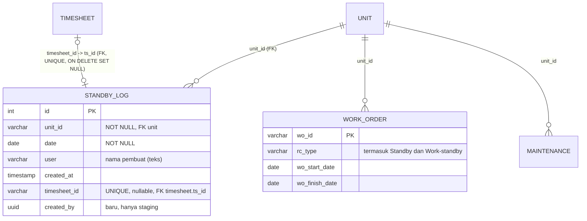

# Rencana perubahan ERD Standby (DRAFT untuk diputuskan)

Status: **rencana saja**. Tidak ada tabel, migrasi, atau kode yang diubah. Tujuan perubahan belum ditentukan user, jadi dokumen ini berisi kondisi sekarang, temuan, pilihan, dan pertanyaan.
Semua angka diambil read-only dari DB **live** pada 2026-11-10 (`begin read only`, tidak ada yang diubah). Staging lokal lebih lama (913 baris, live 1175), jadi staging perlu disegarkan dulu sebelum menguji migrasi apa pun.

## 1. Kondisi sekarang

`rental.standby_log` = **satu baris per unit per hari**. Constraint: PK `id`, `UNIQUE (unit_id, date)`, FK ke `rental.unit`, `UNIQUE (timesheet_id)` dengan FK ke `rental.timesheet(ts_id)` (`ON DELETE SET NULL`). Tidak ada trigger, view, atau fungsi DB yang memakainya.

## 2. Temuan dari data live

| Hal | Angka | Artinya |
|---|---|---|
| Baris standby | 1175 (56 unit, 2026-08-26 s/d 2026-11-09) | Tumbuh cepat: 913 di staging, +262 baris. |
| Rentang berurutan per unit | 426 rentang, rata-rata 2,8 hari, terpanjang 70 hari | Pengguna mencatat dalam **rentang**, tapi disimpan harian. |
| Punya link timesheet | 58 dari 1175 (sekitar 5%) | Sebagian besar standby tidak terhubung ke timesheet. Sebaran per bulan: Sep 57, Okt 1, Nov 0, jadi tampaknya fitur link ini berhenti dipakai. |
| `timesheet_id` yatim | 0 | FK sehat. |
| Kolom `user` terisi | 100 dari 1175 | Pembuat umumnya tidak tercatat (data v1/bot). |
| Duplikat unit+tanggal | 0 | Dijaga constraint UNIQUE. |
| Work order bertipe `Standby` | 99 (+ 4 `Work-standby`) | **Standby tercatat di dua tempat**: tabel `standby_log` dan work order dengan `rc_type = 'Standby'`. |
| Hari standby yang beririsan dengan work order unit yang sama | 244 | Aturan "standby tidak boleh bentrok dengan WO" di v2 tidak berlaku di data v1/live. |

## 3. Masalah yang terlihat
1. **Model harian vs cara pakai berupa rentang:** mengubah atau menghapus satu rentang berarti menyentuh puluhan baris; tidak ada identitas "satu kejadian standby".
2. **Dua sumber kebenaran:** `standby_log` dan WO `rc_type = 'Standby'` berpotensi menghitung hal yang sama dua kali.
3. **Link timesheet per hari** (`UNIQUE`) memaksa satu timesheet = satu hari standby; hampir tidak dipakai.
4. **Pembuat:** `user` berupa teks; `created_by` (uuid) baru ada di staging.
5. **Aturan bentrok** hanya dijaga di kode v2, tidak di DB (v1 bisa menulis tumpang tindih dengan WO/maintenance).

## 4. Pilihan (belum dipilih)

**A. Pertahankan per hari, rapikan saja (risiko paling kecil).** Tetap `standby_log`; lengkapi `created_by` (sudah ada di staging), tambah index bila perlu. Daftar per rentang dihitung saat dibaca (sudah ada: `GET /api/standby/ranges`). Tidak mengubah v1.

**B. Tabel periode sebagai sumber utama.** Tabel baru `rental.standby` (`standby_id`, `unit_id`, `start_date`, `finish_date`, `remarks`, `created_by`, `created_at`), dengan exclusion constraint agar periode satu unit tidak tumpang tindih (butuh ekstensi `btree_gist`). Data harian dibuat lewat view `standby_day` (`generate_series`). Mengubah atau menghapus satu standby menjadi satu baris. Risiko: v1 membaca dan menulis `standby_log` langsung, jadi butuh masa transisi (view kompatibel atau penulisan ganda) dan nasib link `timesheet_id` harus diputuskan.

**C. Satukan ke work order.** Standby menjadi work order `rc_type = 'Standby'`, `standby_log` dihapus. Menghilangkan duplikasi, tapi paling besar dampaknya (v1, timesheet, valuation, laporan) dan menyentuh semua yang memakai `work_order`.

Rekomendasi sementara: **A sekarang**, **B** kalau tujuannya mempermudah ubah/hapus per rentang. **C** hanya kalau Anda memang ingin satu konsep. Ini baru usulan; tujuan Anda yang menentukan.

## 5. Pertanyaan yang perlu dijawab
1. Apa tujuan utama perubahan ERD ini (ubah/hapus per rentang, hilangkan duplikasi dengan WO, laporan, atau yang lain)?
2. Apakah v1 harus tetap berjalan normal selama dan setelah perubahan (menulis ke `standby_log`)?
3. WO bertipe `Standby` (99) dan `Work-standby` (4): tetap sebagai WO, atau dianggap data standby?
4. Link standby ke timesheet (58 baris): masih dipakai? Kalau tidak, boleh dilepas?
5. 244 hari standby yang beririsan dengan WO: biarkan, tandai, atau dibersihkan?
6. Siapa boleh mengubah atau menghapus standby, dan apakah perlu izin baru (`standby:edit`, `standby:delete`)?

## 6. Pengamanan (berlaku untuk semua pilihan)
- Live **tidak diubah**. Semua migrasi dicoba di staging; staging disegarkan dulu dari live karena sudah tertinggal.
- Migrasi hanya menambah (tabel/kolom/index/view baru); setiap file punya `.rollback.sql`.
- Backup `standby_log` sebelum migrasi live; jalankan saat sepi.
- Cek dulu kode v1/n8n yang menyentuh `standby_log` (`SELECT *`, `INSERT` tanpa daftar kolom).
- Setiap endpoint yang berubah dicatat di `docs/Aturan-Endpoint.md`; setiap migrasi baru masuk open list di `docs/Rental-System-v2-Planning.md`.
