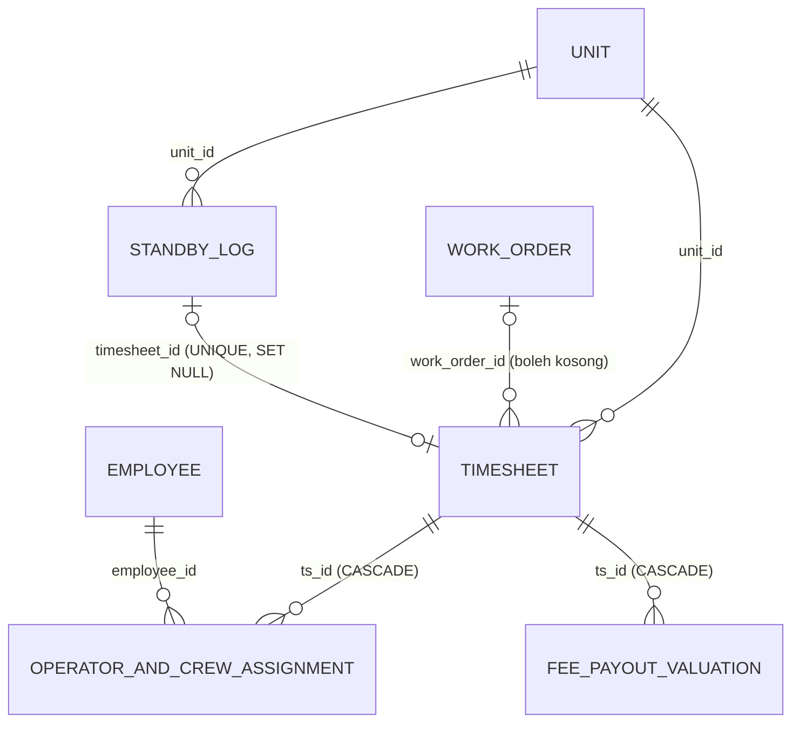
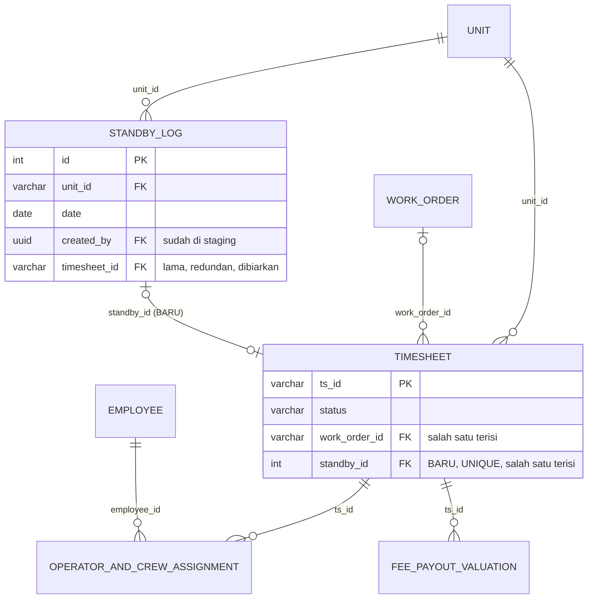

# Rencana perubahan ERD Standby

Status: rencana asli (2026-11-10) **sudah sebagian direalisasikan di staging dan kode v2**; lihat "Status realisasi" di bawah (dicek 2026-11-13). Bagian 1 sampai 8 adalah rencana asli dan tidak diubah. **Live belum disentuh** untuk skema ini.
Semua angka diambil read-only dari DB **live** pada 2026-11-10 (`begin read only`). Staging lokal tertinggal (913 baris standby, live 1175), jadi staging harus disegarkan dulu sebelum menguji migrasi apa pun.

## Status realisasi (dicek 2026-11-13)
Sumber pengecekan: kode `main` (PR #14, `705e3ff`), file migrasi, dan staging `company_staging` (read-only). Live tidak diperiksa ulang pada tanggal ini; status live mengikuti open list di `Rental-System-v2-Planning.md`.

### Keputusan (bagian 4)
| # | Rencana | Status | Catatan |
|---|---|---|---|
| 1 | Standby berfee lewat timesheet, tanpa tabel fee baru | **Terealisasi** | Tidak ada tabel fee baru; `fee_payout_valuation`, `operator_and_crew_assignment`, `timesheet_valuation` tidak berubah |
| 2 | Kolom `timesheet.standby_id` | **Terealisasi di staging**, belum live | `2026-11-10_timesheet_standby_id.sql`: integer boleh kosong, FK `ON DELETE RESTRICT`, `UNIQUE` |
| 3 | `CHECK` tepat-satu `work_order_id` atau `standby_id` | **Terealisasi di staging**, belum live | `2026-11-10_timesheet_one_parent_check.sql`: `NOT VALID` lalu `VALIDATE`; di staging sudah tervalidasi |
| 4 | Bersihkan timesheet tanpa WO | **Terealisasi** (oleh user, di live) | Staging: 0 timesheet tanpa WO dari 1384 |
| 5 | Daftar standby per rentang dihitung saat dibaca | **Terealisasi** | `GET /api/standby/ranges` (PR #10) |
| 6 | v2 dicoba di staging dulu, v1 tidak diubah | **Terealisasi** | Staging disegarkan (1175 baris standby, sama dengan live); v1 tidak diubah |
| 7 | Penegakan aturan di langkah approve | **Terealisasi di v2** | Status `Standby` wajib `standbyId` dan tanpa WO; status lain wajib WO; pesan error jelas |

### Langkah (bagian 6)
| Langkah | Status | Catatan |
|---|---|---|
| 1 Segarkan staging | Selesai | |
| 2 Cek trigger `trg_log_timesheet` | Selesai | Memakai `to_jsonb(NEW/OLD)`, kolom baru aman |
| 3 Putuskan hal terbuka | **Sebagian** | Lihat tabel pertanyaan di bawah |
| 5 Migrasi `standby_id` | Selesai di staging | |
| 6 Tanpa backfill link lama | Sesuai rencana | Link lama `standby_log.timesheet_id` (58) dibiarkan |
| 7 Uji `CHECK NOT VALID` / `VALIDATE` | Selesai di staging | |
| 8 Endpoint v2 timesheet standby | **Selesai** | `POST /api/standby/:id/timesheet` (izin `timesheet:create`, audit log, `Aturan-Endpoint.md`), ditambah jalur approve standby dan `GET /api/timesheet-approvals/standby`. Web: halaman Review punya kotak Standby dan daftar standby per tanggal. **Belum ada halaman web untuk membuat timesheet standby langsung dari daftar Standby** |
| 9 Alur fee tidak berubah | Sesuai rencana | |
| 10 Backup live | **Belum** | |
| 11 Hapus timesheet tanpa WO di live | Selesai | Oleh user |
| 12 Migrasi `standby_id` di live | **Belum** | |
| 13 `CHECK` tepat-satu di live | **Belum** | Tetap paling akhir |
| 14 Catat di open list | Selesai | `Rental-System-v2-Planning.md`, migrasi live butir 7 sampai 12 |

### Pertanyaan terbuka (bagian 7)
| # | Pertanyaan | Status |
|---|---|---|
| 1 | Satu unit-hari boleh Work dan Standby sekaligus? | **Belum diputuskan resmi.** Di kode: boleh. `POST /api/standby/:id/timesheet` hanya memberi peringatan, dan approve standby tidak memeriksa timesheet lain di unit dan tanggal yang sama |
| 2 | Pilihan standby di approve diambil dari mana? | **Terjawab di kode:** dari `standby_log` untuk unit dan tanggal yang sama (satu baris per unit per hari); kalau unit tidak terbaca dari OCR, form menampilkan daftar standby pada tanggal itu |
| 3 | Kapan approve pindah dari v1 ke v2? | **Belum.** Jalur approve v2 sudah siap di staging, belum di live |
| 4 | Fee: satu total per timesheet atau per orang? | **Belum**, tidak disentuh |
| 5 | WO bertipe `Standby` (99) dan 244 hari standby beririsan WO | **Belum.** Pembuatan WO v2 hanya memberi peringatan bentrok, tidak memblokir |
| 6 | Izin `standby:edit` dan `standby:delete` | **Belum.** Di staging hanya ada `standby:view` dan `standby:create`, dan tidak ada endpoint ubah atau hapus standby v2 |
| 7 | 16 file gambar timesheet yang dihapus | **Belum** |

### Hal baru di luar rencana asli
- **Kolom `ts_type`** (enum `work`, `failed`, `standby`): `2026-11-13_timesheet_ts_type.sql` dan `2026-11-13_timesheet_ts_type_required.sql`. Baris lama diisi `work` (1384), kolom NOT NULL, dan constraint `timesheet_ts_type_standby_check` (`ts_type = 'standby'` kalau dan hanya kalau `standby_id` terisi). Baru di staging.
- **Dampak ke data lama:** 180 timesheet berstatus `Standby` yang berinduk WO kini ber-`ts_type = 'work'`, jadi "status Standby" di data lama tidak sama dengan `ts_type standby`. Pemetaan status `Failed` dan `Failed-maintenance` ke `ts_type` belum diputuskan (approve v2 sementara menyimpan `work`).
- **Perubahan perilaku approve:** status `Standby` tidak lagi boleh memakai work order.
- **Penambahan urutan deploy (bagian 6):** `ts_type_required` memakai NOT NULL tanpa nilai bawaan, sehingga insert v1/bot/n8n yang tidak menyebut `ts_type` akan ditolak. Jalankan **paling akhir bersama langkah 13**. Backfill-nya juga menulis satu catatan UPDATE ke `ts_log` per baris timesheet.
- **`standby_log.timesheet_id`** (kolom v1) tidak diisi oleh jalur v2; hanya `timesheet.standby_id` yang diisi.

### Ringkasan
- **Sudah:** skema dan constraint di staging, endpoint dan jalur approve standby di v2, pembersihan timesheet tanpa WO di live.
- **Belum:** seluruh langkah di live (backup, kolom, `CHECK`, `ts_type`), penyesuaian v1, halaman web untuk membuat timesheet standby dari daftar Standby, izin ubah dan hapus standby, serta keputusan soal fee, irisan WO dan standby, dan gambar.

## 1. Latar belakang (keterangan user)
- `standby_log` mencatat **unit mana yang standby** pada hari tertentu (jadwal).
- Sebagian standby **diberi fee kepada operator** (dan crew). Yang memutuskan user/admin, dan perlu nama operator serta crew. Contoh: K-01 dan K-02 standby pada 01/01, tetapi hanya K-02 yang berfee.
- Standby berfee **memakai timesheet**. Awalnya lewat work order, lalu dipisah karena standby bukan kerja.
- v1 pernah menaruh fee standby langsung di tabel fee (`standby_id` di `fee_payout_valuation` dan `operator_and_crew_assignment`), lalu dibuang pada 2026-10-30. Alasan user: tidak mau menambah banyak tabel untuk satu tujuan.

## 2. Kondisi sekarang

Fakta penting:
- `standby_log`: satu baris per unit per hari (`UNIQUE (unit_id, date)`), tidak punya trigger, view, atau fungsi DB yang memakainya.
- Tidak ada hubungan langsung antara `standby_log` dan tabel assignment atau fee. Satu-satunya jalur: `standby_log.timesheet_id` ke `timesheet`, lalu `ts_id` di assignment dan fee.
- `standby_log.timesheet_id` hanya hasil backfill satu kali (2026-10-30) dan **tidak ditulis oleh aplikasi v1**.
- `fee_payout_valuation`: `ts_id` NOT NULL, hanya satu penerima per timesheet (tidak ada kolom karyawan), 2 baris di live (data uji `DEBUG-01/02`).

## 3. Temuan dari v1 dan data live

| Hal | Temuan |
|---|---|
| Aturan tambah standby (v1) | Satu tanggal per permintaan; ditolak (409) jika unit punya WO atau maintenance pada tanggal itu, atau sudah standby. Hanya ada GET, POST, DELETE (tanpa edit). |
| Baris standby | 1175 (56 unit, 2026-08-26 s/d 2026-11-09); 426 rentang berurutan, rata-rata 2,8 hari, terpanjang 70 hari. |
| Link timesheet di `standby_log` | 58 dari 1175 (September 57, Oktober 1, November 0): tidak dijaga lagi. |
| Timesheet berstatus `Standby` | 180 (semuanya punya assignment OPERATOR, 3 punya CREW). Hanya 60 unit-hari yang ada di `standby_log`. |
| WO dari timesheet Standby | 177 dari 180 tertaut ke WO Retail/Contract, 2 ke WO tipe Standby, 1 tanpa WO. `timesheet.work_order_id` boleh kosong. |
| WO bertipe `Standby` / `Work-standby` | 99 / 4 (data lama; laporan v1 mengabaikan tipe `Standby`). |
| Standby beririsan dengan WO | 244 hari (pembuatan WO v1 tidak memeriksa `standby_log`). |
| Timesheet tanpa WO | Sebelumnya 18 (17 Work, 1 Standby), 2024-09 s/d 2026-10-24. **Sekarang 0** (16 dihapus, 2 ditautkan). v1 mengizinkan timesheet tanpa WO (WO diisi belakangan lewat penautan), jadi bisa muncul lagi. |
| 16 timesheet Standby | berbagi unit dan tanggal yang sama dengan timesheet lain. |
| Asal timesheet di v1 | WhatsApp/n8n/OCR hanya mengisi `buffer_timesheet` (antrean review, WO belum wajib). Timesheet dibuat **hanya** di endpoint approve (`/api/review`, `index.js` sekitar baris 1120 sampai 1300): `INSERT INTO timesheet` + insert `operator_and_crew_assignment` dalam satu transaksi, lalu `buffer_timesheet` di-update. `work_order_id` berasal dari `documentData.wo_id` (isian reviewer menimpa data buffer). Di seluruh repo v1 hanya ada satu `INSERT INTO timesheet` (dikonfirmasi user: timesheet hanya berasal dari buffer yang di-approve). |
| Penautan WO belakangan | `linkTimesheetToWorkOrder` (index.js:3460, dipanggil di baris 3532 dan 3590) mengisi `work_order_id` untuk timesheet tanpa WO (unit sama, tanggal dalam periode WO). Hanya menangani error `23505`. |
| Hapus standby di v1 | `DELETE /api/standby_log/:id` tidak memeriksa timesheet; kegagalan FK tampil sebagai pesan error mentah. |

## 4. Keputusan
1. Standby berfee tetap lewat **timesheet** (status `Standby`) dan jalur fee yang sudah ada. Tidak ada tabel fee baru.
2. Timesheet menunjuk **induknya** lewat kolom baru `timesheet.standby_id`, sejajar dengan `work_order_id`.
3. Aturan: **tepat satu** dari `work_order_id` atau `standby_id` terisi: `CHECK (num_nonnulls(work_order_id, standby_id) = 1)`.
4. Timesheet tanpa WO dibersihkan oleh user: **sudah dilakukan** (16 dihapus, 2 ditautkan ke WO; lihat langkah 11).
5. `standby_log` tetap sebagai fakta unit-hari (per hari). Daftar per rentang dihitung saat dibaca (`GET /api/standby/ranges`, sudah ada).
6. **v2 disiapkan dan dicoba di staging dulu** (`company_staging`, localhost:5433). v1 tidak diubah dulu dan tetap menautkan timesheet Standby ke WO seperti sekarang; `CHECK` ditunda sampai v2 siap dan berjalan di live.
7. Titik penegakan aturan adalah **langkah approve** (buffer ke timesheet), bukan WhatsApp: Work wajib WO, Standby wajib `standby_id`, dengan pesan error yang jelas (bukan error database).

Alasan tidak memakai opsi lain: tabel periode (B) tidak cocok karena fee bisa berbeda per hari; menyatukan ke work order (C) berlawanan dengan arah v1 dan keputusan user.

## 5. ERD rencana

Satu-satunya perubahan skema: `timesheet.standby_id` (integer, boleh kosong, FK ke `standby_log(id)`, `UNIQUE`) dan `CHECK` tepat-satu. `fee_payout_valuation`, `operator_and_crew_assignment`, dan `timesheet_valuation` **tidak berubah**.

FK `timesheet.standby_id` dibuat `ON DELETE RESTRICT` (bukan `SET NULL`): `SET NULL` akan membuat timesheet tanpa induk dan melanggar `CHECK`; standby yang sudah punya timesheet dan fee memang tidak boleh terhapus diam-diam. Pesan penolakan hapus standby di v1 sebaiknya diperjelas.

Catatan data lama: 58 link lama di `standby_log.timesheet_id` **tidak di-backfill** ke `standby_id`, karena timesheet itu sudah punya WO dan akan melanggar "tepat satu".

## 6. Urutan langkah

**Fase A: persiapan (tidak mengubah live)**
1. Segarkan staging dari live.
2. Baca fungsi trigger `trg_log_timesheet` (mencatat ke `ts_log`) dan pastikan kolom baru tidak merusaknya.
3. Putuskan hal yang masih terbuka (bagian 7).
4. ~~Cek penulis lain ke `timesheet`.~~ **Gugur:** timesheet hanya dibuat di endpoint approve (satu-satunya `INSERT INTO timesheet` di v1; dikonfirmasi user). Yang tetap perlu diperhatikan di v1: `linkTimesheetToWorkOrder` (akan menautkan timesheet standby ke WO dan melanggar constraint) dan `DELETE /api/standby_log/:id` (pesan error mentah). Keduanya baru perlu disesuaikan di v1 jika `CHECK` dipasang sebelum v1 dipensiunkan.

**Fase B: dicoba di staging**
5. Migrasi tambah `timesheet.standby_id` + FK + `UNIQUE` (+ rollback). Belum ada `CHECK`.
6. Tidak ada backfill link lama.
7. Bersihkan 18 timesheet tanpa WO di staging, lalu uji `CHECK ... NOT VALID` dan `VALIDATE CONSTRAINT`.

**Fase C: v2 (kode, tanpa menyentuh live)**
8. Endpoint v2 untuk timesheet standby: buat, isi `standby_id` (WO dikosongkan), validasi server "tepat satu", izin baru, catat di audit log, perbarui `docs/Aturan-Endpoint.md`.
9. Alur fee tidak berubah (tetap `ts_id`).

**Fase D: live (user yang memutuskan waktunya)**
10. Backup `timesheet`, `operator_and_crew_assignment`, dan `standby_log`.
11. ~~Hapus 18 timesheet tanpa WO.~~ **Selesai (dicek read-only 2026-11-09 UTC / 2026-11-10).** Hasilnya: 16 timesheet dihapus (semuanya berstatus Work dan `work_order_id`-nya kosong) dan 2 ditautkan ke WO oleh user (`K40261024`, satu-satunya yang berstatus Standby, ke `WO-1787824525832`; `NPB01113`, Work, ke `WO26-1104-008`). Sekarang **0** timesheet tanpa WO (total 1384; Work 1180, Standby 180, Failed 14, Failed-maintenance 10). Tidak ada assignment, fee, atau valuation yatim; link `standby_log` tetap 58. Riwayat 16 baris yang dihapus tersimpan lengkap di `rental.ts_log` (termasuk `image_filename`; kolom `changed_by` kosong). Tersisa: 16 file gambar di server tidak ikut terhapus dan belum dibersihkan. Jumlah assignment turun 1465 menjadi 1452 (net -13), belum dicocokkan persis (tidak ada yang yatim).
12. Jalankan migrasi kolom `standby_id`.
13. Pasang `CHECK` tepat-satu. **Paling akhir**, setelah v1 tidak lagi membuat timesheet tanpa WO dan fungsi penautan v1 tidak menyentuh timesheet standby; jika belum, insert dan penautan di v1 akan gagal.
14. Catat semua migrasi di open list `docs/Rental-System-v2-Planning.md`.

### Urutan deploy (skema, v1, v2 memakai database live yang sama)
Push ke `main` v1 langsung di-deploy otomatis (Coolify), jadi setiap kombinasi kode lama/baru dengan skema lama/baru harus tetap jalan. Prinsip: **tambahan dulu, pembatasan terakhir.**

| Urutan | Langkah | Alasan |
|---|---|---|
| 1 | Migrasi tambah `timesheet.standby_id` (boleh kosong, tanpa `CHECK`) | Hanya menambah; v1 memakai daftar kolom eksplisit sehingga tetap jalan. |
| 2 | Deploy v2 (endpoint timesheet standby, validasi di approve) | v2 butuh kolom itu; kalau sebelum langkah 1, endpoint v2 gagal. |
| 3 | Perubahan v1 (opsional) | Tidak boleh menyebut kolom baru sebelum langkah 1 selesai; push ke `main` v1 langsung aktif. Dengan v2 lebih dulu, langkah ini bisa kosong. |
| 4 | Pasang `CHECK` tepat-satu | Paling akhir: satu-satunya langkah yang bisa mematahkan sistem berjalan. Jika ditolak, approve di-rollback (transaksi) dan dokumen tetap pending di buffer, tetapi error v1 berupa error server umum (hanya `23505` yang ditangani). |

Rollback: `CHECK` bisa dicabut dalam hitungan detik; penghapusan kolom paling terakhir dan paling berisiko.

Urutan yang mengikat: 11 sebelum 13 (sudah terpenuhi), dan 13 paling akhir (satu-satunya langkah yang bisa mematahkan v1). Setelah langkah 11, `CHECK` tepat-satu secara teknis lolos validasi di live (semua timesheet punya WO); satu-satunya penghalang tersisa adalah v1 yang masih mungkin membuat timesheet tanpa WO.

## 7. Pertanyaan yang masih terbuka
1. Satu unit-hari boleh punya timesheet Work **dan** Standby sekaligus? (16 kasus di live.)
2. Di langkah approve v2, kalau statusnya Standby: pilihan standby diambil dari `standby_log` untuk unit dan tanggal yang sama? (belum dijawab)
3. Kapan langkah approve pindah dari v1 ke v2? Menentukan kapan `CHECK` bisa dipasang (v1 baru perlu disesuaikan bila `CHECK` dipasang sebelum itu).
4. Pembagian fee: satu total per timesheet, atau nominal per operator dan crew? (`fee_payout_valuation` hanya menyimpan satu `total_fee` per baris.)
5. WO bertipe `Standby` (99) dan 244 hari standby yang beririsan dengan WO: dibiarkan, ditandai, atau dibersihkan?
6. Siapa boleh mengubah atau menghapus standby (izin `standby:edit` dan `standby:delete`)?
7. 16 file gambar dari timesheet yang dihapus: dibersihkan atau dibiarkan? (nama file ada di `rental.ts_log`)

## 8. Pengamanan (berlaku untuk semua langkah)
- Live **tidak diubah** tanpa instruksi user. Semua migrasi dicoba di staging dulu; setiap file punya `.rollback.sql`.
- Migrasi hanya menambah (kolom/constraint); `CHECK` dipasang `NOT VALID` lalu divalidasi.
- Backup sebelum menyentuh data live; jalankan saat sepi.
- Setiap endpoint yang berubah dicatat di `docs/Aturan-Endpoint.md`; setiap migrasi baru masuk open list di `docs/Rental-System-v2-Planning.md`.
